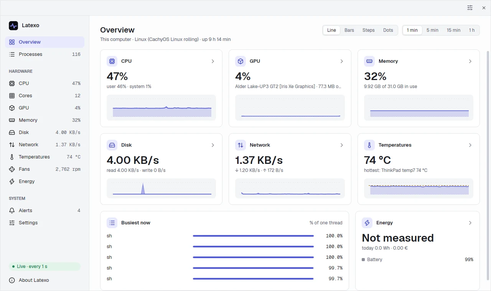

# Latexo

[](https://github.com/tanisperez/latexo/releases/latest)
[](https://github.com/tanisperez/latexo/actions/workflows/build.yml)
[](LICENSE)


Latexo ("heartbeat" in Galician) is a native system monitor for Linux and Windows. It shows the
processor and each of its cores, the graphics card, memory, disks, network, temperatures, fans
and power with live charts, lists every process and ends the ones that misbehave, and warns you
when a rule you set is met: a hot CPU, a full disk, memory running out. It is written in Rust,
starts in a moment and stays light while it watches.

[Download](https://github.com/tanisperez/latexo/releases/latest)

<picture>
  <source media="(prefers-color-scheme: dark)" srcset="site/img/overview-dark.webp">
  
</picture>

- **Overview**: every resource at a glance, the busiest processes and the power used today.
- **Cores**: usage, temperature and clock of each core as bars, a heat map over time, a small
  chart per core or a map of the processor.
- **Processes**: sort by any column, filter yours or the system's, search by name or PID, end
  a process or its whole tree.
- **Charts your way**: line, bars, steps or dots, over the last minute or the last hour.
- **Alerts**: rules on temperatures, usage, disks, power and fans, with how long they must last.
- **Energy**: the measured power added up into kWh today and this month, with its cost.
- **Settings inside the window**, in English, Spanish, Galician and Italian, light or dark.

## Install

Download the package for your system from the
[latest release](https://github.com/tanisperez/latexo/releases/latest):

| System | Package |
| --- | --- |
| Windows | `latexo-X.Y.Z-windows-x86_64-setup.exe` (installs for your user, no administrator), or the portable `.zip` |
| Debian, Ubuntu | `latexo_X.Y.Z_amd64.deb` |
| Fedora, openSUSE | `latexo-X.Y.Z-1.x86_64.rpm` |
| Arch | `latexo-X.Y.Z-1-x86_64.pkg.tar.zst` |
| Any Linux | `latexo-X.Y.Z-x86_64.AppImage` or the `.tar.gz` |

Some readings need more than a normal user can read: on Linux the processor package power is
readable by root only, and on Windows fans and most temperatures need a driver from the board
maker. Settings, "Sensors and permissions", shows what this computer gives.

## Building from source

Rust stable (see `rust-toolchain.toml`). On Linux, the development packages of Wayland, X11,
xkbcommon, fontconfig and Vulkan (the list is in `.github/workflows/build.yml`).

```sh
make run       # debug build and run
make release   # optimized build in target/release
make test      # every test
make help      # every target
```

## Documentation

- `docs/architecture.md`: the crates, the sampling thread and the files Latexo writes.
- `docs/design-system.md`: colors, sizes and screens, from the design.
- `docs/i18n.md`: translations.
- `docs/releasing.md`: how a version is released.

## Built with

- [Rust](https://www.rust-lang.org)
- [gpui-kit](https://crates.io/crates/gpui-kit), Zed's GPU accelerated UI framework with its
  components
- [telaio](https://github.com/tanisperez/telaio), the design system and application shell
  shared with Postino and ted
- [sysinfo](https://crates.io/crates/sysinfo), the readings shared by Linux and Windows

## License

Apache-2.0, see [LICENSE](LICENSE) and [NOTICE](NOTICE).
